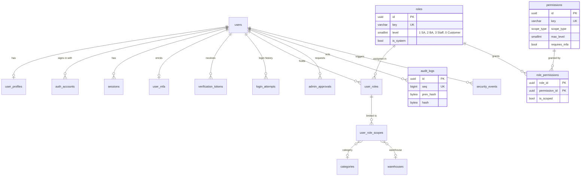
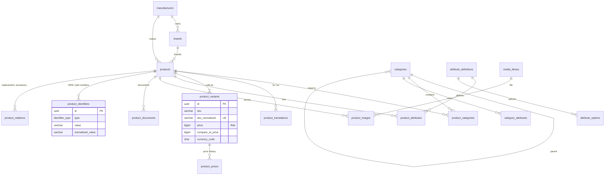
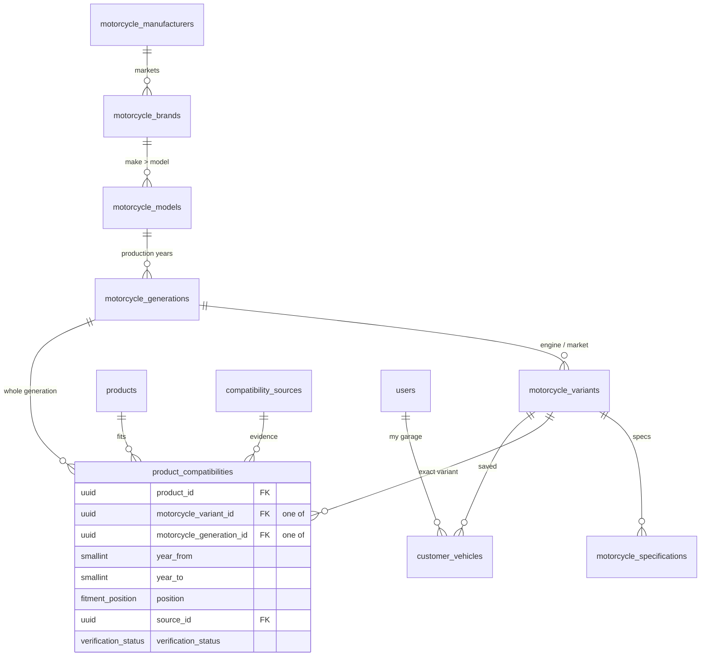
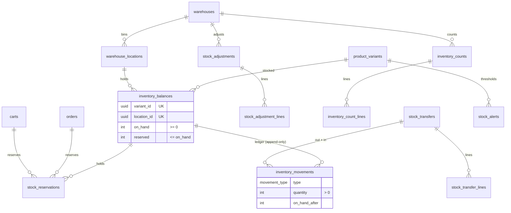
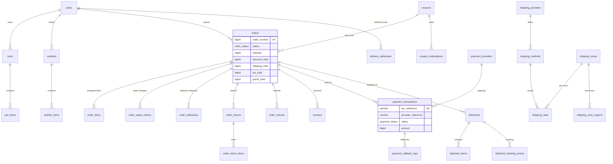
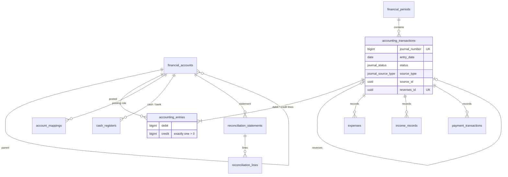
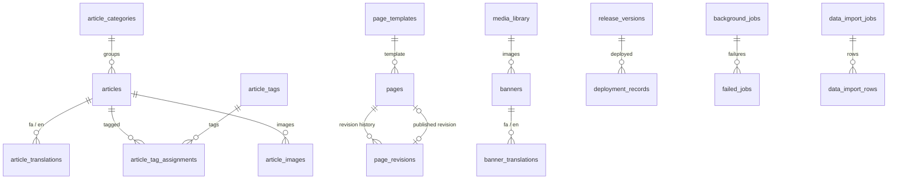

# Entity relationship diagrams

Implemented in Phase 3. Diagrams show the main tables and keys per area; every column, index and rule is in `prisma/schema/*.prisma` and [DATABASE.md](DATABASE.md). Translation tables (`*_translations`, keyed by entity and `locale`) are drawn only where they matter.

## Identity, RBAC and audit

## Catalog

## Motorcycles and fitment

## Inventory

## Sales, payments and shipping

## Accounting

## Content, page builder and system

Standalone system tables: `locales`, `currencies`, `system_settings`, `store_settings`, `tax_rules`, `seo_metadata`, `feature_flags`, `page_sections`, `page_builder_components`, `menus`, `outbox_events`, `idempotency_keys`, `notifications`, `system_logs`, `data_export_jobs`.
